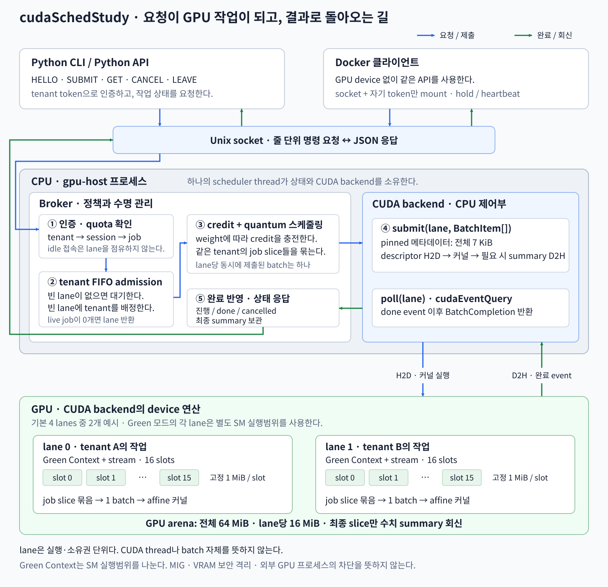
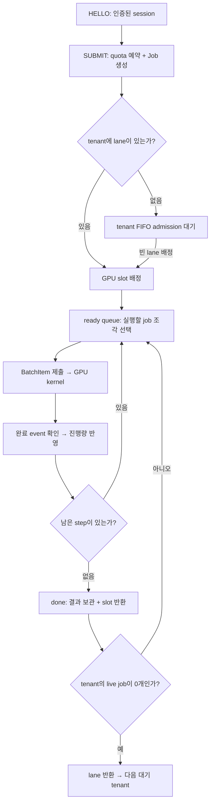
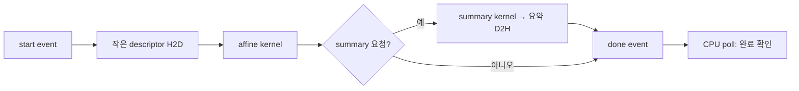

# 이론

컴퓨터공학을 대학교에서 전공하고 CS지식을 아는데에 있어서 동시에 최신 AI 개발 동향들은 필수적으로 파악하고 있어야 한다고 생각한다. 그래야 백엔드 개발에 있어서 AI와 연결이 더 수월해지고 CS 지식을 잘 활용할 수 있기 때문이다.
AI분야에서 사용되는 단어들의 뜻정도는 최대한 머리속에 집어넣어야 AI분야에 지식이 많고 CS지식이 부족한 사람들과 협업을 진행할 때 수월하다고 생각한다. 
이 관점에서 AI와 CS가 동시에 활용되는 부분, 둘이 정면에서 1대1로 만나는 부분이 바로 GPU의 운용과 LLM 서빙이다. LLM서빙은 AI분야 하는 사람들이 vLLM같은 라이브러리들 사용하면 된다고 하지만, 
LLM말고 다른 다양한 모델들에 대해서는 cuda로 직접 코딩하는 CS분야 전문가와의 협력이 무조건적으로 필요하다. 그래서 지금 이 프로젝트로 cuda응용 관련해서 공부해보고 싶다.

cuda는 NVIDIA에서 만든 GPU를 운용하는 라이브러리를 말하며 cuda의 가장 큰 특징은 우리가 흔히 cuda를 GPU를 운용하는 로켓의 발사대와 같은 역할을 한다고 생각하지만, 오히려 CPU를 host삼아서 GPU를 device로 휘두르는 CPU 의 비중이 높은 프로그램이다.
엔비디아가 돈이 많아지면서 cuda에 여러 최적화기법들이 함수로써 들어가고 여러가지 모델 관련된 과정들을 semantic하게 굴려주지만 오히려 이런게 보편화되고 바이브코딩이 보편화될 수록 cuda와 친해질 필요가 강하게 느껴진다.

먼저 현대의 gpu 운용 환경은 다양한 작업들을 CPU가 외부에서 받아서 이걸 스케쥴링하는 구조이다. 여러 작업들을 PagedAttention형태로 Page단위로 나뉘어진 블록에 대해 GPU연산이 진행되고 이 GPU연산이 원활하게 진행될 수 있도록 메모리관리가 'Continuous Batching'으로써 이뤄진다.

>스케쥴러가 Graph형태로 작업 관계들 주어진 것을 기반으로 작업 순서를 정하고 작업 iteration마다 'Continuous Batching'을 통해 메모리 배치가 관리된다. cuda는 GPU를 device로써 host(CPU)가 휘두른다.

---

추가로 공부해야 하는 키워드들
1. FlashAttention, FlashDecoding(둘이 다른 개념임!! 연산의 순서 최적화에 대한 이야기)
2. Prefill vs Decode 관리(무조건 Prefill이 짱인게 현재 트렌드임)
3. MoE 최적화(활성함수 여러개로 이뤄진 FFN 여러개 입구가 존재하는데 얘들 중에 Router이 직접 TopKIndices를 k개 선택해서 선택된 FFN에만 가중치가 전달된다. 최근엔 FFN하나가 하나의 Expert 역할을 하는게 아니라 Fine-Grained expert, Shared expert 구조가 엄청 연구되고 있고 MoE의 균형 조절 장치, Top-1와 Top-2구조에서의 안정성 관리가 중요하다)
4. GPUinitiatedcommunication(계산이 끝나고 통신을 준비하면 오버헤드 존재하니 cpu는 미리 gpu한테 요청받아서 RDMA. cpu관련 회사들 주식이 주목받는 이유가 이쪽때문임!!)
5. GPU 여러대의 분산시스템에서의 통신(Topology Aware)
6. 메모리 어쩌고(https://youtu.be/9Qf_QLt7IWY 이 영상 보셈)

# 아키텍쳐설명
<!-- SPDX-License-Identifier: Unlicense -->

이 프로젝트는 **사용자의 요청을 받아 GPU에서 실행하고, 끝난 작업의 자원을 다음 사용자에게 넘기는 과정**을 직접 구현한 실습이다. Python client는 작업을 요청하고, 호스트의 C++ broker는 실행 순서와 사용량을 결정한다. CUDA backend는 GPU 메모리와 실제 kernel 실행을 맡는다.

현재 kernel은 float 배열에 곱셈과 덧셈을 반복하는 수치 연산이다. 이 연산을 여러 작업으로 나누어 돌리면서 LLM serving에서도 필요한 요청 관리, batching, GPU 상태 유지, 취소와 메모리 재사용을 살펴본다. 실제 모델·KV cache·토큰 생성은 이후에 붙일 수 있는 확장 단계다.

처음에는 아래 그림과 **요청 하나를 따라가는 3번**을 읽으면 전체 흐름이 잡힌다. 그다음 메모리와 CUDA 실행 부분을 보면 각 코드가 왜 필요한지 연결된다. 빌드와 실행 명령은 [사용법](docs/usage.md)에 따로 정리했다.

## 1. 전체 구조: 요청을 받는 CPU, 계산을 수행하는 GPU



그림의 위쪽은 사용자 환경이고, 가운데는 호스트에서 실행되는 `gpu-host` 프로세스다. 아래쪽은 그 프로세스가 사용하는 GPU다. CUDA backend에도 CPU에서 실행되는 제어 코드가 있고, `__global__` kernel이 GPU에서 실행된다.

사용자는 `SUBMIT`으로 계산의 크기와 반복 횟수를 전달한다. broker는 인증·quota·대기열을 확인하고, 실행할 작업 조각을 골라 backend에 넘긴다. backend가 kernel을 제출한 뒤 CPU는 다른 요청을 처리하고, 나중에 CUDA event의 완료를 확인해 결과를 돌려준다.

이때 GPU 주소와 CUDA context를 관리하는 주체는 broker다. 사용자 client는 작업 ID와 JSON 결과를 받는다. Docker를 사용해도 이 요청 경로는 같다. 컨테이너에는 자기 token과 broker socket을 전달하고, GPU 연산은 호스트의 broker가 수행한다.

## 2. 코드를 읽기 전에 구분할 여섯 가지

| 이름 | 이 프로젝트에서 뜻하는 것 | 예시 |
| --- | --- | --- |
| **tenant** | token, quota, weight, 작업 목록을 공유하는 사용자 단위 | `alice` |
| **session** | broker에 연결한 Unix socket 한 개 | Alice의 터미널 두 개는 session 두 개 |
| **job** | 한 session이 제출한 계산 작업 | 원소 65,536개를 10 step 계산 |
| **lane** | context·stream·완료 event·slot들을 묶은 실행 통로 | 기본 구성의 lane 0~3 |
| **slot** | job의 float 배열이 머무는 고정 크기 GPU 메모리 구간 | 기본 slot 하나는 1 MiB |
| **batch** | 같은 lane에서 이번에 함께 실행할 job 조각들의 목록 | J1의 1 step + J2의 1 step |

예를 들어 Alice가 터미널 두 개를 열면 tenant는 하나이고 session은 둘이다. 두 session은 같은 quota와 lane을 사용하고, 같은 tenant의 job을 조회하거나 취소할 수 있다. 다만 한 session이 끊겼을 때 자동으로 취소되는 범위는 **그 session이 제출한 job**이다.

lane은 이 프로그램이 정의한 실행 자원 묶음이다. CUDA의 thread나 block과는 역할이 다르다. slot은 데이터를 보관하는 자리이고, batch는 그 데이터에 이번에 수행할 계산 목록이다. 이 셋을 나눠 생각하면 메모리와 스케줄링 코드가 훨씬 읽기 쉬워진다.

실제 객체는 [`src/server.cpp`](src/server.cpp)의 `Client`, `Tenant`, `Job`, `Flight`에 있다. `Flight`는 제출된 batch의 job ID와 진행 step을 기록해서 GPU 완료를 CPU의 작업 상태에 다시 연결한다.

## 3. 요청 하나를 처음부터 끝까지 따라가기

Alice가 다음 작업을 제출한다고 생각해보자.

```text
SUBMIT 65536 10 7 4
       │     │  │ │
       │     │  │ └─ rounds: 한 step 안에서 원소마다 FMA를 4회 반복
       │     │  └─── seed: 초기값 생성에 사용하는 값
       │     └────── steps: 총 10 step 진행
       └──────────── elements: float 원소 65,536개
```

**① `HELLO TOKEN`: 연결을 사용자와 연결한다.** broker는 token을 확인하고 session을 tenant에 등록한다. 이 단계에서 새 GPU lane을 잡지는 않는다. 작업 없이 접속해 있는 사용자가 많아도 실행 통로를 미리 차지하지 않도록 만든 것이다. 다른 session도 작업을 돌리고 있지 않다면 `lane=-1`은 정상 응답이다.

**② `SUBMIT`: 작업을 접수하고 quota를 예약한다.** broker가 입력 범위와 tenant의 slot 한도를 확인한 뒤 `Job`을 만든다. 접수 응답에는 작업 ID와 `queued` 상태가 들어간다. 이 시점부터 job은 quota 하나를 사용하지만, lane을 기다리는 중이라면 아직 GPU slot은 배정되지 않았다.

**③ admission: 빈 lane에 tenant를 들인다.** `waiting_tenants`는 tenant 이름을 보관하는 FIFO 대기열이다. `admit_waiters()`가 빈 lane을 발견하면 가장 먼저 기다린 tenant를 배정하고, 그 tenant의 live job마다 slot을 잡는다. job 여러 개를 제출해도 tenant가 admission 대기열에 여러 번 들어가지는 않는다. 이렇게 lane과 GPU slot을 배정받은 실행 대상을 뒤에서는 resident tenant/job이라고 부른다.

**④ schedule: 이번에 계산할 양을 정한다.** 기본 `quantum=1`이라면 이 job에서 이번 batch에 들어갈 진행량은 1 step이다. 65,536개 원소에 각각 FMA를 4회 수행하므로 이번 조각의 credit 비용은 `65,536 × 1 × 4 = 262,144`다. credit과 batch 여유가 충분하면 같은 tenant의 다른 job 조각도 함께 들어간다.

**⑤ submit: backend가 GPU 실행을 예약한다.** `BatchItem` 목록에는 slot 번호, 진행량, 초기화 여부, 마지막 조각 여부 등이 들어 있다. backend가 이를 GPU용 descriptor로 만들고 같은 lane stream에 복사와 kernel 실행을 넣는다. 첫 조각에서는 GPU가 seed로 초기값을 만들고, 다음 조각에서는 slot에 남은 값을 읽어 계산을 이어간다.

**⑥ retire: 완료된 만큼 상태를 갱신한다.** `retire()`가 CUDA event 완료를 확인하면 `completed_steps`를 늘린다. 아직 9 step이 남았으면 job을 ready queue 뒤에 넣는다. 새 요청과 기존 작업을 다시 고려하면서 다음 batch를 구성한다.

**⑦ finish: 마지막 결과를 저장하고 자원을 반환한다.** 총 10 step을 채우면 `done`이 된다. 결과 요약은 CPU에 보관하고, GPU slot은 지운 뒤 재사용한다. Alice의 마지막 live job이 끝났다면 session이 계속 연결되어 있어도 lane을 반환한다. 사용자는 `GET ID`로 완료 결과를 조회할 수 있다.



여기에는 두 종류의 대기가 있다. **admission 대기**는 tenant가 실행 통로를 받기 위한 것이다. **ready queue**는 tenant 내부에서 다음에 실행할 job 조각의 순서를 보관하고, lane을 받은 뒤 scheduler가 사용한다. admission을 기다리는 중에도 제출한 job은 ready queue에 들어간다.

## 4. CPU 스케줄러: 실행 순서를 무엇으로 정하는가

서버는 하나의 scheduler thread가 상태를 소유한다. [`Server::run()`](src/server.cpp)은 GPU 완료 반영 → history 정리 → 다음 batch 구성 → socket 입출력 대기를 반복한다. 사용자마다 C++ thread를 하나씩 만드는 구조 대신, nonblocking socket과 짧은 GPU 제출·조회 호출로 여러 연결을 처리한다.

여기서 `poll`이라는 이름이 두 번 등장한다. OS의 `poll()`은 socket의 읽기·쓰기 가능 여부를 기다린다. `Backend::poll(lane)`은 해당 lane의 CUDA event가 끝났는지 확인한다. GPU가 아직 계산 중이면 backend 조회는 `nullopt`를 반환하고, 서버는 다른 연결과 lane을 처리한다.

실행량 배분에는 **weight에 비례하는 누적 credit**을 사용한다. tick마다 현재 lane을 가지고 live job이 있는 tenant들에게 다음과 같이 credit을 보충한다. 실제 코드는 정수 나눗셈, 최소 지급량, 누적 상한도 적용한다.

```text
지급 credit ≈ batch_elements × tenant.weight / resident tenant의 weight 합
조각의 비용 = elements × min(quantum, 남은 steps) × rounds
```

weight가 1과 3인 두 resident tenant라면 credit을 약 1:3으로 받는다. 이는 제출 가능한 연산량을 조절하는 값이다. 각 lane의 SM 수는 backend 설정으로 결정되고, 실제 실행시간과 응답시간에는 kernel 비용과 메모리 대역폭도 영향을 준다.

`tick_ms`는 credit 보충 주기다. 기본값 2 ms마다 credit을 보충하되, 이미 credit이 충분하면 이전 batch 완료 직후 다음 batch를 제출할 수 있다. GPU batch가 pending이면 socket poll timeout을 1 ms 이하로 줄여 약 1 ms 간격으로 완료를 확인하도록 한다. 실제 확인 간격에는 OS 스케줄링과 요청 처리 시간도 영향을 준다. idle 상태에서는 socket 이벤트를 기다리므로 CPU가 항상 1 ms마다 바쁘게 도는 방식은 아니다.

tenant 내부의 ready queue는 진행 중인 job을 뒤로 돌려가며 다음 조각을 고른다. 선두의 큰 job에 credit이 부족하면 그 job을 맨 앞에 남기고 credit을 더 모은다. 뒤쪽의 싼 job이 매번 credit을 전부 써서 큰 job이 계속 굶는 상황을 막는 대신, 작은 job도 함께 기다릴 수 있다.

lane을 받는 순서는 별도의 FIFO다. weight가 높아도 admission 순서를 추월하지 않는다. 현재 resident tenant의 GPU 상태를 옮기거나 lane을 강제로 빼앗는 기능은 없으므로, live job을 계속 유지하는 tenant가 있으면 뒤 tenant가 오래 기다릴 수 있다.

## 5. Continuous batching: batch를 언제 바꾸는가

같은 tenant의 J1과 J2가 각각 100 step을 진행하고 `quantum=1`이라고 하자. credit과 batch 크기가 허용하면 두 job에서 1 step씩 꺼내 같은 kernel batch에 넣는다. GPU 데이터는 각자의 slot에 남고, CPU는 완료된 조각의 진행량을 기록한다.

그사이 J3가 제출되면 **현재 실행 중인 kernel의 구성을 바꾸는 대신 다음 batch를 만들 때** J3를 고려한다. J2가 먼저 끝나면 다음 batch에서 빠진다. 이렇게 batch의 구성원은 실행 조각 사이에서 바뀐다.

```text
batch 1: [J1의 조각] [J2의 조각]
            ↓ J3 제출
batch 2: [J1의 조각] [J2의 조각] [J3의 첫 조각]
            ↓ J2 완료
batch 3: [J1의 조각] [J3의 조각]
```

이 예시는 credit과 batch 크기가 충분한 경우다. 실제 scheduler는 비용과 한도를 확인해 이번에 들어갈 job을 선택한다. 서로 다른 tenant는 각자 lane에서 별도의 batch를 실행하므로, 한 batch에 다른 사용자의 포인터를 섞지는 않는다.

LLM decode의 iteration마다 요청을 넣고 빼는 구조와 연결해서 볼 수 있지만, 여기서 quantum은 합성 연산의 step 단위다. token 하나가 생성되는 단계와 대응시키려면 실제 모델과 prefill/decode 비용 모델을 추가해야 한다.

## 6. 메모리: GPU에 무엇이 남아 있는가

backend는 시작할 때 큰 GPU 데이터 arena를 한 번 확보하고, lane별·slot별 구간을 재사용한다. 기본 구성은 다음과 같다.

```text
4 lanes × 16 slots × 262,144 floats × 4 bytes = 64 MiB

slot 1개       = 1 MiB
lane의 데이터 = 16 MiB
최대 slot 수  = 64개
```

`Backend::allocate()`는 이 arena에서 빈 slot의 CPU 관리 정보를 예약하고 번호를 반환한다. job마다 `cudaMalloc()`을 반복하는 경로가 아니다. 원소 수가 작은 job도 고정 slot 하나를 사용하므로, 기본 구성에서 원소 하나짜리 job 역시 quota상 1 MiB 예약을 소비한다.

job이 여러 quantum으로 나뉘어도 같은 slot에 계속 머문다. CPU는 진행량과 실행 목록만 갱신하고, GPU의 다음 조각은 이전 조각이 남긴 값을 이어 읽는다. 실행 단계 사이에 요청별 GPU 상태를 유지하는 부분을 직접 볼 수 있는 구조다.

CPU에는 전체 입력 배열 대신 **작은 descriptor와 결과 요약**을 pinned memory에 둔다. pinned memory는 페이지를 고정한 host 메모리로, 여기서는 stream에 비동기 복사를 제출할 때 사용한다. 기본 전체 크기는 7,168 bytes, 즉 7 KiB다. 큰 입력 배열의 초기값은 첫 kernel에서 만들어 H2D 입력 복사를 줄였다.

상태 조회에서 다음 숫자들은 서로 다른 의미다.

| 필드 | 무엇을 세는가 |
| --- | --- |
| `reserved_bytes` | lane을 기다리는 job까지 포함한 논리 quota 예약 |
| `allocated_bytes` | resident job에 실제 배정한 GPU slot 용량 |
| `backend.pool_bytes` | broker가 시작할 때 확보한 GPU 데이터 arena |
| `backend.pinned_bytes` | descriptor/result용 pinned CPU 메모리 |

작업이 끝나면 reserved와 allocated는 줄지만 arena는 broker 종료까지 유지된다. 따라서 slot 반환은 다음 작업이 같은 공간을 쓰도록 하는 동작이다. `nvidia-smi`의 전체 메모리 사용량에는 arena 외에 context·descriptor·결과·진단 buffer 등의 비용도 포함된다.

## 7. CUDA backend: 하나의 batch가 kernel로 펼쳐지는 과정

### 실행할 SM을 정하는 context와 순서를 정하는 stream

SM(Streaming Multiprocessor)은 GPU 안에서 CUDA block을 실행하는 연산 자원이다. Green 모드에서는 GPU의 SM resource를 조회하고, 장치가 요구하는 분할 크기와 정렬 조건을 확인한다. `cudaDevSmResourceSplitByCount()`로 SM 집합을 나누고 `cudaGreenCtxCreate()`와 `cudaExecutionCtxStreamCreate()`로 lane의 context와 nonblocking stream을 만든다.

검증한 GTX 1660 Super는 22 SM이며 기본 네 lane은 각각 4 SM을 사용했다. **stream이 속한 context가 실행 가능한 SM 범위를 정하고, 그 범위 안에서 block 배치는 GPU가 결정한다.** block 수나 thread 수를 지정하는 것과 SM 집합을 지정하는 것은 다른 설정이다.

각 lane의 slot 주소는 공통 arena 안의 별도 구간을 가리킨다. Green Context가 VRAM·L2·메모리 대역폭을 독립된 GPU처럼 분리하는 것은 아니며, 다른 host GPU 프로세스의 사용을 막는 것도 아니다. SM 집합을 나눠도 동시 실행이나 일정한 지연시간을 보장하지 않는다. 경계는 [NVIDIA Green Context 문서](https://docs.nvidia.com/cuda/cuda-programming-guide/04-special-topics/green-contexts.html)에서 확인할 수 있다. compute와 memory를 GPU instance로 나누는 [MIG](https://docs.nvidia.com/datacenter/tesla/mig-user-guide/introduction.html)는 지원 장치와 기능이 별개다.

`--mode streams`는 일반 stream들이 GPU SM을 공유하는 비교 모드다. Green 초기화가 실패하면 오류를 보고하며, 사용자가 지정하지 않은 streams 모드로 자동 전환하지 않는다. 다른 GPU에서는 CUDA architecture와 lane·SM 설정을 맞추고 실제 `sm_counts`를 확인해야 한다.

### thread 하나가 맡는 계산

kernel의 thread 하나는 job 배열의 원소 하나를 계산한다. 첫 실행이면 seed로 초기값을 만들고, 이번 조각의 반복 횟수만큼 FMA를 수행한 뒤 같은 주소에 저장한다.

```text
factor = seed % 97
x[i]   = float32(factor × .001f + (i % 97) × .001f)

이번 조각에서 quantum_steps × rounds번 반복:
    x[i] = fmaf(x[i], .9999f, .0001f × factor)
```

초기값의 곱셈과 덧셈은 `__fmul_rn`/`__fadd_rn`을 사용해 각각의 float 반올림을 유지한다. 이후 반복은 곱셈과 덧셈을 합쳐 한 번 반올림하는 FMA다. CPU의 `reference_value()`와 비교해서 GPU 계산이 같은 값을 만드는지 검사한다.

block당 thread 수는 256이다. 크기가 비슷한 job은 2D grid로 펼친다.

```text
grid.x = ceil(batch의 최대 elements / 256)
grid.y = batch의 job 수

blockIdx.y                         → 어느 job인가
blockIdx.x × 256 + threadIdx.x      → 그 job의 어느 원소인가
```

1,024개 원소를 가진 job 세 개라면 grid는 `(4, 3)`이고 각 block에 thread 256개가 들어간다. 각 job은 descriptor에 있는 자기 slot 주소를 사용한다. 범위를 벗어난 thread는 계산하지 않고 반환한다.

job 크기 차이가 크면 사각형 grid에 불필요한 block이 많이 생긴다. 사각형 block 수가 실제 필요한 block 수의 1.25배를 넘으면 **packed 1D grid**를 사용한다. job마다 필요한 block 범위를 이어 붙이고, block의 thread 0이 해당 job의 descriptor를 찾아 shared memory에 둔다. 나머지 thread는 동기화 후 같은 descriptor로 계산하므로 검색을 thread마다 반복하지 않는다.

### CPU와 GPU가 주고받는 순서

descriptor는 실행할 slot의 GPU 주소, 원소 수, 반복 횟수 등을 담은 작은 구조체다. 한 lane stream에는 다음 순서로 작업이 들어간다. H2D는 host→device 복사, D2H는 device→host 복사를 뜻한다.



server는 중간 조각에서 summary를 생략하고 마지막 조각에서만 결과를 요청한다. 중간마다 수치 요약을 CPU로 복사하지 않고, 큰 데이터 배열은 계속 GPU slot에 유지한다. summary가 없어도 완료 event와 slot 정보를 받아 진행량을 갱신할 수 있다.

최종 summary에는 첫·마지막 원소, 첫 최대 8개 원소와 그 표본의 합, 관찰한 SM mask가 들어간다. `sample_checksum`은 표본 합이며 전체 벡터 checksum은 아니다. `gpu_ms`도 descriptor 복사와 선택적 summary 반환을 포함한 batch event 시간에 연산량 비율을 곱해 job에 나눈 값이므로 개별 job을 독립 실행한 시간과 구분해서 읽어야 한다.

backend는 **lane당 미완료 batch 하나**만 허용한다. descriptor나 결과 buffer를 GPU가 사용하는 동안 CPU가 덮어쓰지 않도록 하는 수명 규칙이다. `ContextScope`는 Green stream에 대응하는 driver context를 잠시 current로 설정했다가 복원해 runtime/driver 호출과 debugger·sanitizer의 context를 맞춘다. enqueue 실패로 일부 작업만 제출된 경우에는 lane을 poison해서 재사용을 거절한다.

## 8. 취소·퇴장·재사용: GPU가 쓰는 메모리를 언제 돌려줄 수 있는가

취소에는 CPU에서 요청을 접수하는 시점과 GPU 자원을 반환하는 시점이 있다. lane을 기다리는 job은 아직 GPU에 제출되지 않았으므로 바로 취소하고 quota를 반환할 수 있다. 실행 중인 job은 `cancel=true`를 기록하고 현재 batch의 완료 event를 기다린다.

실행 중 kernel을 강제로 끊는 대신, 안전한 실행 조각의 경계에서 job을 끝내는 방식이다. `CANCEL`의 응답이 아직 `running`일 수 있으므로 `GET`으로 `cancelled`에 도달했는지 확인한다. 해당 job 자체가 inflight가 아니어도 같은 lane의 batch가 pending이면 slot 반환을 기다린다.

반환 시에는 해당 slot **전체**를 `cudaMemsetAsync()`로 지우고 다음 job이 재사용하게 한다.

```text
기존 batch 완료 확인
 → 같은 stream에 slot 전체 wipe 제출
 → CPU의 slot 예약 반환
 → 다음 job의 descriptor·초기화·계산 제출
```

wipe와 다음 실행을 같은 stream에 넣기 때문에 다음 job이 wipe를 추월하지 못한다. CPU는 매번 wipe 완료까지 synchronize하지 않아도 순서를 지킬 수 있다. 첫 실행 전에 취소된 예약은 GPU 데이터를 쓰지 않았으므로 추가 wipe가 필요 없다. broker 종료 시에는 backend 소멸자가 모든 stream을 기다린 뒤 메모리와 context를 해제한다.

퇴장 명령은 적용 범위가 다르다.

| 동작 | 정리하는 범위 |
| --- | --- |
| `LEAVE` / 연결 종료 | 그 session이 제출한 미완료 job |
| Docker `leave` | 컨테이너의 프로세스·연결 종료, 해당 session들의 job 정리 |
| `REVOKE` | tenant token 무효화, 모든 session과 미완료 job 정리 |
| `FORGET` | revoke와 drain 후 tenant 등록·history 삭제, 이름과 등록 용량 회수 |

마지막 live job이 끝나고 pending batch가 없으면 lane을 다음 tenant에게 넘긴다. idle 연결이 남아 있어도 가능하다. 반환되는 것은 tenant와 lane의 배정이며, lane의 context·stream과 전체 arena는 다음 사용자가 재사용하도록 broker 안에 남는다.

작업 결과와 등록 정보는 broker의 RAM에 있고, terminal job은 tenant별 최근 128개만 보관한다. 오래된 job ID는 `not_found`가 될 수 있고, broker를 재시작하면 사용자를 다시 등록해야 한다.

## 9. Docker를 붙였을 때 사용자가 들어오고 나가는 방식

Docker는 사용자의 파일·프로세스·네트워크 환경을 나눈다. [`containers/manage.py`](containers/manage.py)는 rootless Docker로 nonroot·read-only filesystem·network none·capability 제거와 CPU·메모리·PID 제한을 적용한다. 전달하는 host 경로는 broker socket 디렉토리와 해당 사용자의 token 파일이다.

`join`은 컨테이너 안에 `hold` client를 실행하고 실제 `HELLO` 성공을 확인한다. `hold`는 기본 2초마다 작은 `HEARTBEAT`로 broker와 인증 상태를 확인한다. broker가 끝나거나 token이 revoke되면 hold도 종료한다.

`client alice run ...`은 `docker exec`로 별도 client 프로세스와 별도 session을 연다. hold는 사용자 환경의 생존을 확인하고, run session은 자신이 제출한 job의 결과를 기다린다. 두 session은 같은 tenant의 quota와 lane을 공유한다.

중복 `join`은 기존 컨테이너의 mount와 broker 건강 상태를 확인한 뒤 재사용한다. 중복 `leave`도 성공하며, 같은 tenant의 동시 join/leave는 파일 lock으로 직렬화한다. 새 가입이 인증 실패·timeout·interrupt로 끝나면 생성한 컨테이너를 회수한다. 이 때문에 반복 가입이 hold를 중복 생성하거나 실패한 사용자 환경을 남기는 일을 줄일 수 있다.

OS 격리는 [`containers/audit.py`](containers/audit.py)가 실제 namespace·mount·cgroup 값으로 확인한다. 다른 tenant의 job 접근 거절은 broker가 검사한다. host의 container 관리 도구와 rootless Docker daemon 권한은 운영자가 소유하는 구성이다. 자세한 명령과 격리 범위는 [컨테이너 문서](docs/containers.md)에 있다.

## 10. 파일을 어떤 순서로 읽으면 되는가

| 순서 | 파일과 주요 지점 | 읽으면서 확인할 것 |
| --- | --- | --- |
| 1 | [`python/gpuctl.py`](python/gpuctl.py): `Session`, `Connection.raw_request()` | 명령 한 줄이 어떻게 JSON 응답 하나와 연결되는가 |
| 2 | [`src/server.cpp`](src/server.cpp): `command()` | HELLO·SUBMIT·GET·CANCEL·LEAVE가 어떤 상태를 바꾸는가 |
| 3 | 같은 파일의 `wait_for_lane()`, `admit_waiters()`, `schedule()` | quota 예약, lane 대기와 batch 선택이 어떻게 나뉘는가 |
| 4 | [`include/gpu_backend.hpp`](include/gpu_backend.hpp): `Backend`, `BatchItem` | 서버가 backend에 맡기는 일과 수명 규칙은 무엇인가 |
| 5 | [`src/gpu_backend.cu`](src/gpu_backend.cu): `Backend::submit()`, `affine_batch()`, `affine_packed_batch()` | descriptor가 thread/block/grid의 계산으로 어떻게 바뀌는가 |
| 6 | backend의 `poll()`·`release()`, 서버의 `retire()`·`finish()`·`release_lane()` | GPU 완료를 CPU 상태로 반영하고 안전하게 재사용하는가 |
| 7 | [`tests/test_integration.py`](tests/test_integration.py), [`tools/backend_stress.cu`](tools/backend_stress.cu) | 수치·소유권·취소·재접속·잘못된 수명 호출을 어떻게 검증하는가 |

첫 독해에서는 socket parsing의 모든 분기보다 `Tenant → Job → BatchItem → BatchCompletion` 연결을 따라가면 좋다. 이후 `cancel_session()`과 `release()`를 다시 읽으면 연결이 사라진 뒤에도 GPU가 잠시 계산 중인 상황을 왜 따로 관리하는지 보인다.

## 11. LLM serving과 multi-GPU로 확장한다면

현재 구현에서 직접 확인하는 것은 **요청의 수명과 GPU 실행의 수명을 연결하는 구조**다. quantum 사이 batch 변경은 동적 요청 구성으로, slot의 지속 상태는 요청별 GPU 상태 유지로, credit과 weight는 사용량 정책으로 이어진다. 여기에 실제 LLM을 붙이려면 모델 연산, prefill/decode 스케줄링, 가변 크기 KV-cache allocator, token streaming과 model admission이 필요하다.

현재 slot은 고정 크기 float 배열이므로 KV cache의 page allocator와 역할을 구분해서 읽어야 한다. 이 합성 workload의 FMA 처리량 역시 token/s 성능으로 환산할 수 없다. 최적화 측정의 조건과 tail latency를 포함한 결과는 [최적화 기록](docs/optimization.md), 실제 GPU·sanitizer·Docker 검증은 [검증 기록](docs/verification.md)에 있다.

multi-GPU로 가는 다음 단계는 device마다 backend·arena·lane의 소유권을 나누는 것이다. 그 위에서 어느 device에 job을 배치할지, H2D/P2P 복사와 event 의존성을 어떻게 이어줄지, 한 device의 실패를 어떻게 처리할지 설계할 수 있다. 현재 코드는 단일 GPU에서 이 문제들의 바탕이 되는 CPU 스케줄링과 메모리 수명을 직접 읽고 실험할 수 있도록 구성되어 있다.

실행을 시작할 때는 [사용법](docs/usage.md), wire 명령과 응답 필드를 확인할 때는 [API 문서](docs/api.md)를 함께 보면 된다.
