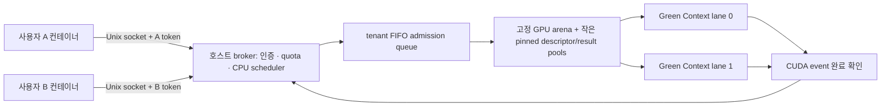

<!-- SPDX-License-Identifier: Unlicense -->
# CPU → memory → CUDA → 사용자 결과



## 무엇을 분리하는가

Docker 컨테이너는 사용자 파일·프로세스·network/IPC/mount namespace를 분리합니다. GPU device나 Docker daemon socket을 전달하지 않습니다. 사용자 token으로 인증한 broker API만 이용합니다. 관리 스크립트와 host의 rootless Docker socket은 운영자만 사용해야 합니다. 같은 host 계정을 함께 공유하면서 관리 도구까지 열어주는 것은 이 사용자 경계에 포함되지 않습니다.

broker는 tenant별 credential, job 소유권, quota, lane을 관리합니다. 같은 tenant의 여러 연결은 quota와 lane을 공유하고 서로의 job을 조회·취소할 수 있습니다. 연결 종료 시 취소되는 범위는 그 연결이 제출한 작업입니다. 서로 다른 tenant는 job ID를 알아도 조회할 수 없습니다. 관리자만 전체 tenant 정보를 조회합니다. 일반 사용자의 global stats에는 전체 사용량이 포함되므로 사용량 은닉까지 제공하지는 않습니다.

Green Context lane들은 하나의 broker가 나눈 서로 다른 SM 집합을 사용합니다. 이 프로젝트의 1660 Super에서는 각 4 SM이며, 실제 커널 `%smid` 관찰로 집합이 겹치지 않음을 확인합니다. 이 API는 실행 동시성·forward progress나 전용 GPU와 같은 지연시간을 보장하지 않습니다. host의 다른 primary context는 전체 GPU를 사용할 수 있습니다. 메모리 보호·GPU 오류 경계는 별도 hardware partition이 아니며, L2와 VRAM 대역폭은 공유합니다. [NVIDIA Green Context 문서](https://docs.nvidia.com/cuda/cuda-programming-guide/04-special-topics/green-contexts.html)

따라서 이 구현의 GPU 데이터 경계는 trusted broker가 사용자에게 device pointer와 임의 커널을 주지 않는 것으로 성립합니다. 악의적인 임의 CUDA 코드 실행을 지원하는 범용 GPU container runtime은 아닙니다.

## 각 파일의 책임

| 파일 | 책임 |
| --- | --- |
| `src/server.cpp` | Unix socket reactor, 관리자/tenant 인증, job 상태, quota, weighted scheduler, event retirement, JSON 응답/trace |
| `include/gpu_backend.hpp` | CPU scheduler에서 사용하는 제한된 backend 계약 |
| `src/gpu_backend.cu` | Green Context/stream 생성, GPU/pinned 풀, affine kernel, event와 buffer 수명 |
| `python/gpuctl.py` | 표준 라이브러리만 사용하는 wire client와 CLI |
| `containers/manage.py` | 외부 cache의 rootless Docker, 사용자 컨테이너 생성/퇴장 |
| `containers/audit.py` | 실제 namespace/device/cgroup/secret mount 검사 |
| `tests/test_integration.py` | 실제 GPU와 broker를 통과하는 계약 검증 |
| `tools/release.py` | 텍스트 소스/라이선스 표식 검사와 source-only export |

## 메모리와 수명

backend는 시작할 때 `lanes × slots_per_lane × max_elements × sizeof(float)` 크기의 GPU 데이터 arena를 할당합니다. 초기값은 첫 affine kernel 내부에서 생성하므로 큰 pinned initialization pool과 데이터 H2D가 필요 없습니다. descriptor/result만 pinned 공간에 유지하며 기본값은 7,168 bytes입니다. job은 고정 슬롯 한 개 분량의 논리 quota를 먼저 예약하고 lane admission 때 실제 slot을 배정받습니다. 작은 job도 같은 슬롯 비용을 지불합니다. variable-size allocator나 실제 KV cache의 page allocator는 아닙니다.

`reserved_bytes`는 admission 대기를 포함한 논리 quota 예약이고, `allocated_bytes`는 현재 resident job에 배정한 슬롯 크기입니다. `backend.pool_bytes`는 GPU에 유지되는 물리 풀 크기이며, 초기 CUDA context 비용 등 드라이버 전체 메모리 사용량은 포함하지 않습니다. 작업을 마치면 예약이 줄어들지만 물리 풀은 broker 종료까지 유지됩니다.

한 lane에는 미완료 batch 하나만 둡니다. pinned descriptor → H2D → kernel → 필요시 summary/D2H → 완료 event 순서로 stream에 넣습니다. server는 최종 slice에서만 summary를 요청합니다. backend 사용자는 `report_summary=true`로 중간 수치를 요청할 수 있고 final slice에는 반드시 요청해야 합니다. summary가 없는 completion도 slot/finalized 정보를 반환하며 `summary_available=false`로 수치 부재를 표시합니다. CPU는 `poll()`로 완료 여부를 확인하고 그동안 다른 사용자 입출력과 lane 스케줄링을 처리합니다. 각 Green Context stream 작업은 supported driver API로 변환한 context를 scoped activation하여 runtime/driver context가 일치하게 실행합니다.

job을 취소하거나 연결이 끊겨도 in-flight kernel을 강제로 죽이지 않습니다. 완료 event까지 기다린 뒤 해당 슬롯 **전체**의 zeroing을 같은 stream에 enqueue합니다. 다음 tenant 초기화·계산도 같은 stream에 들어가므로 wipe를 추월할 수 없습니다. release는 host를 synchronize하지 않고 논리 예약을 반환합니다. 첫 실행 전에 취소된 slot은 GPU를 건드리지 않았으므로 wipe를 추가하지 않습니다. lane의 다른 slot도 lane에 미완료 batch가 있으면 회수하지 않습니다. 마지막 live job이 없어지면 idle session이 남아 있어도 lane을 다음 tenant에게 넘깁니다. SIGTERM/admin shutdown은 대기 작업도 취소하고 backend 소멸자가 모든 stream을 동기화한 뒤 메모리를 해제합니다. CUDA enqueue 실패는 lane을 poison하여 재사용하지 않습니다.

## 스케줄링과 continuous batching

HELLO 인증은 lane을 소비하지 않습니다. 첫 live job이 생긴 tenant를 FIFO admission queue에 넣고, 빈 lane이 생기면 해당 tenant의 live job에 slot을 배정합니다. 대기 중 CANCEL/LEAVE/EOF/revoke는 GPU 실행 없이 즉시 quota를 반환할 수 있습니다. admission queue는 현재 resident 작업을 선점하지 않으므로 긴 작업으로 채운 lane을 기다리는 시간에는 상한을 보장하지 않습니다.

매 tick마다 resident 작업이 있는 tenant에 `batch_elements × weight / resident total_weight`만큼 operation credit을 더합니다. 작업 비용은 `elements × quantum_steps × rounds`입니다. lane이 비면 tenant ready queue를 돌며 credit이 있는 작업들을 batch에 묶습니다. 마지막 quantum은 남은 step 수만큼만 실행합니다.

tick은 credit refill만 제한합니다. 이미 credit이 충분한 lane은 이전 batch 완료 뒤 다음 tick을 기다리지 않고 다시 dispatch할 수 있습니다. pending GPU event는 최대 1 ms polling 주기로 확인하므로 아주 짧은 kernel에서는 이 host 대기 시간이 여전히 지연의 일부가 됩니다.

기존 작업이 끝날 때까지 기다리지 않고 새 작업을 다음 quantum의 batch에 넣습니다. 완료·취소된 job은 다음 batch에서 빠지고 슬롯이 반환됩니다. 서로 다른 tenant는 각자 lane에서 별도 batch를 실행하므로 한 kernel에 다른 tenant의 포인터를 섞지 않습니다.

credit이 부족한 ready queue의 첫 작업은 다음 refill을 예약합니다. 더 싼 작업이 모든 refill을 계속 소비해 큰 작업을 굶기는 것을 막습니다. 이 과정에서는 같은 tenant의 뒤쪽 작업도 credit 누적을 기다릴 수 있습니다.

weight는 resident tenant의 제출 연산량을 조절합니다. 같은 크기/rounds의 credit 제한 workload에서 1:3 비율을 검증했습니다. 모든 workload에서 GPU 시간·latency가 정확히 1:3이 되는 SLA는 아닙니다. kernel 비용, 메모리 대역폭, launch/tick 제한과 각 lane의 SM 수가 영향을 줍니다. idle tenant는 lane을 보유하지 않지만 resident tenant의 SM 수 자체를 늘리거나 다른 lane을 빌려주지는 않습니다.

동일·유사 크기 작업은 기존 2D grid로 계산합니다. 사각 grid가 유효 block 수의 1.25배를 넘으면 job별 block 범위를 이어 붙인 packed 1D grid를 사용합니다. block당 한 번 descriptor를 찾아 shared memory에 저장해 작은 작업에 불필요한 대규모 block을 launch하는 비용을 줄입니다. 초기값 multiply/add에는 명시적 round-to-nearest 연산을 사용해 CPU reference와 같은 float 반올림을 유지합니다.

CPU job 조회·취소는 tenant별 index를 사용하고 terminal history는 완료 순서 deque로 제한합니다. 매번 전체 tenant의 job을 scan하거나 history를 정렬하지 않습니다. idle reactor는 socket을 기다리며, GPU batch가 pending이면 1 ms, credit 대기이면 다음 tick 시점으로 poll timeout을 조절합니다.

## 수치 workload와 관찰

각 원소는 float32로 초기화한 뒤 다음 fused multiply-add를 `steps × rounds`번 적용합니다.

```text
factor = seed % 97
x[i] = float32(factor * .001f + (i % 97) * .001f)
x[i] = fmaf(x[i], .9999f, .0001f * factor)
```

완료 결과는 첫 최대 8개 원소, 첫/마지막 원소와 8개 sample의 합입니다. 전체 벡터 checksum은 아닙니다. CPU의 `fmaf` reference와 비교하여 반올림까지 검사합니다. `gpu_ms`는 batch CUDA event 시간에 operation 비율을 곱해 job에 배분한 값이며, 개별 job의 독립 실행 측정치는 아닙니다. `scheduled_elements`는 이름과 달리 FMA operation 수를 센 기존 API 필드입니다.

`sm_mask`는 SM ID 0..63의 관찰 비트입니다. 22 SM인 검증 장비에서는 전체를 표현하지만, SM이 64개를 넘는 장비에서 완전한 격리 증거로 사용할 수 없습니다. API resource 분할과 수치 동작은 이 진단 mask와 별개입니다.

## 확장 경로

현재 backend 계약은 단일 scheduler thread를 전제로 합니다. 새로운 operation은 `BatchItem`과 검증된 kernel dispatch에 추가할 수 있습니다. host 메모리 풀/slot 수명은 그대로 두고 workload를 바꾸는 접근이 첫 단계입니다. 모델 serving에서는 variable-size KV-cache allocator, prefill/decode 비용 모델, 요청 응답 streaming, model admission을 추가해야 합니다. multi-GPU에서는 device별 arena/lane과 명시적인 H2D/P2P/event 의존성을 먼저 분리하는 설계가 적합합니다.
